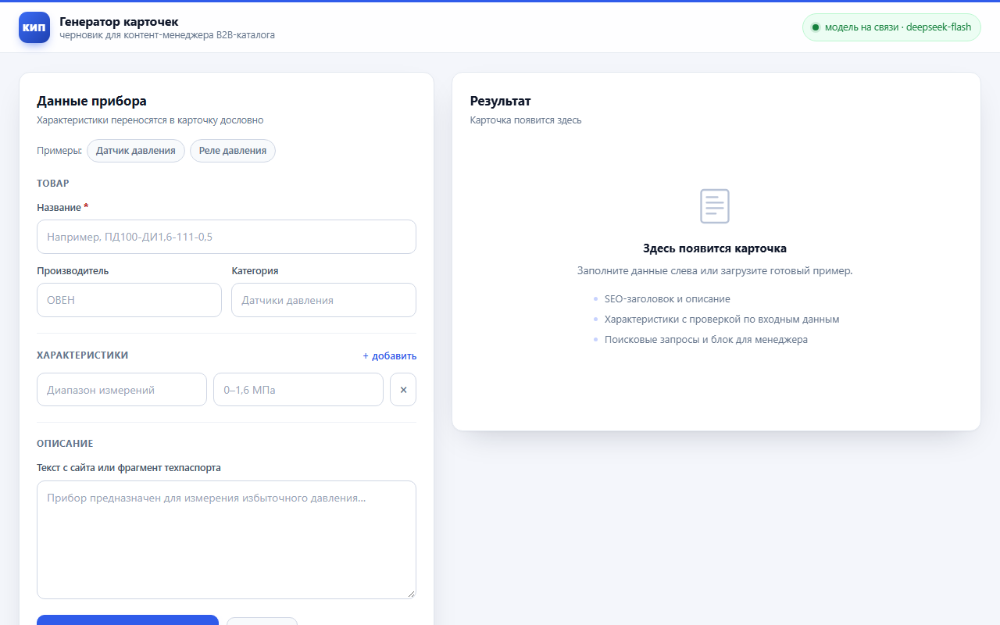
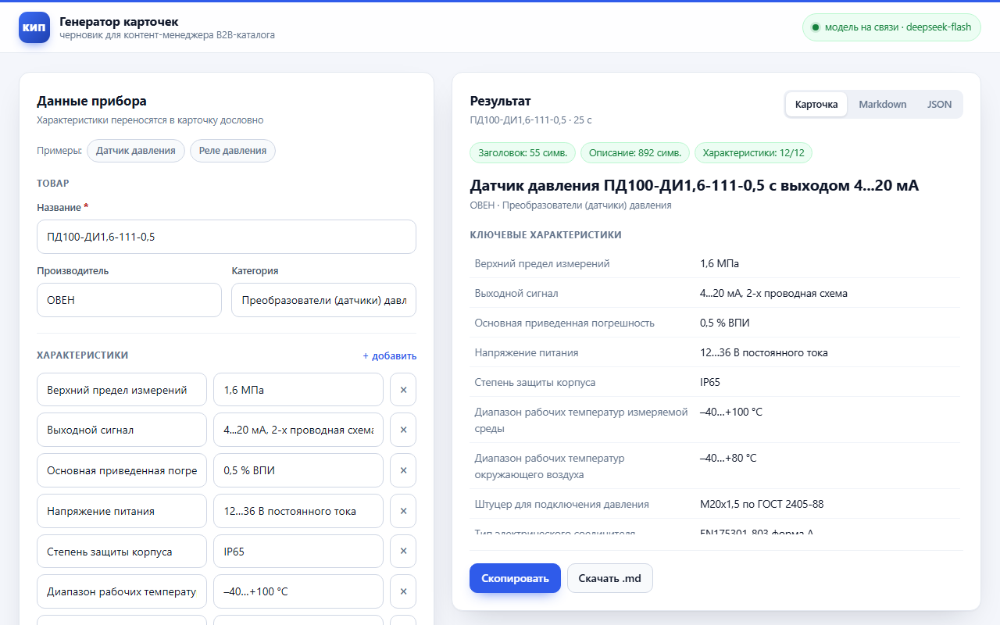
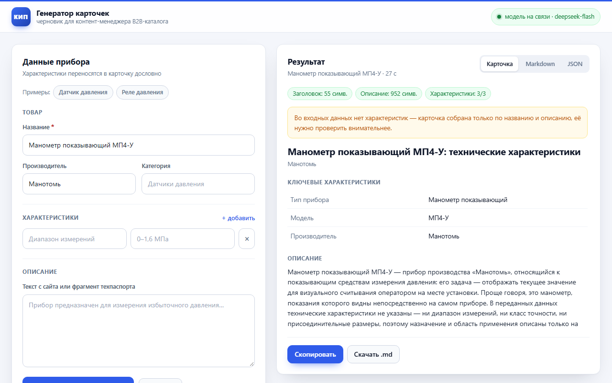

# AI Product Card

Прототип сервиса, который по данным о контрольно-измерительном приборе собирает
черновик карточки товара для B2B-интернет-магазина.

На вход — JSON или веб-форма. На выходе — SEO-заголовок, SEO-описание,
структурированные характеристики, поисковые запросы и коммерческий блок
для менеджера. Всё, чего нет во входных данных, не придумывается: неподтверждённые
характеристики удаляются программно, а недостающие данные попадают в отдельный
список «что уточнить».

## Что умеет

- принимает товар через JSON API или веб-форму;
- ходит в любую OpenAI-совместимую LLM: llama.cpp, Ollama, vLLM, OpenAI и т. п.;
- возвращает результат в трёх видах: карточка в интерфейсе, Markdown, JSON;
- проверяет формальные лимиты (заголовок ≤ 70 символов, описание 800–1 200 символов,
  3–5 запросов) и делает одну попытку автоправки, если они нарушены;
- сверяет каждую характеристику с входными данными и удаляет выдуманные значения,
  показывая, что именно удалено;
- по флагу `VERIFY_LLM` делает второй проход и ищет в описании утверждения,
  которых нет во входных данных;
- перечисляет, каких данных не хватает для полной карточки, в виде
  «Класс точности: данных нет — уточнить у производителя»;
- отдаёт понятные ошибки на битый JSON, пустые поля и недоступную модель.

## Как это выглядит



Полный цикл — загрузка примера, генерация, вкладки «Карточка / Markdown / JSON»,
копирование и скачивание файла (19 секунд, ускорено в 2 раза):
[▶ demo-full.mp4](docs/demo-full.mp4)



Неполные данные — только название и производитель, без характеристик и описания.
Сервис не додумывает значения, а предупреждает и перечисляет, что уточнить
(18 секунд): [▶ demo-incomplete.mp4](docs/demo-incomplete.mp4)



## Быстрый старт

Нужен Python 3.10+.

```bash
git clone <repo-url>
cd ai-product-card

python -m venv .venv

# Windows
.venv\Scripts\activate
# Linux / macOS
source .venv/bin/activate

pip install -r requirements.txt
cp .env.example .env        # Windows: copy .env.example .env
```

В `.env` укажите адрес и имя модели. Примеры для разных вариантов — ниже.

### Вариант 1. llama.cpp

```bash
llama-server -m /path/to/model.gguf --host 127.0.0.1 --port 8092 --ctx-size 16384 --jinja
```

```dotenv
LLM_BASE_URL=http://127.0.0.1:8092/v1
LLM_MODEL=local
```

### Вариант 2. Ollama

```bash
ollama serve
ollama pull gemma4:12b
```

```dotenv
LLM_BASE_URL=http://127.0.0.1:11434/v1
LLM_MODEL=gemma4:12b
```

### Вариант 3. Внешний API (OpenAI и совместимые)

```dotenv
LLM_BASE_URL=https://api.openai.com/v1
LLM_MODEL=gpt-5.5
LLM_API_KEY=sk-...
```

Ключ хранится только в `.env`, файл добавлен в `.gitignore`.

### Подключение своей модели

Сервис работает с любым OpenAI-совместимым API: облачным или локальным.
Порядок для пользователя:

1. Скопировать шаблон: `cp .env.example .env` (в Windows — `copy .env.example .env`).
2. В `.env` раскомментировать блок нужного провайдера и вписать ключ с моделью.
3. Проверить связь: `python scripts/check_llm.py`.
4. Запустить сервис: `uvicorn app.main:app --reload`.

Сменить модель потом — это правка двух-трёх строк в `.env` и перезапуск.
В коде ничего менять не нужно.

| Провайдер | `LLM_BASE_URL` | Пример `LLM_MODEL` |
| --- | --- | --- |
| OpenAI | `https://api.openai.com/v1` | `gpt-5.5` |
| Google Gemini | `https://generativelanguage.googleapis.com/v1beta/openai` | `gemini-3.8-flash` |
| DeepSeek | `https://api.deepseek.com/v1` | `deepseek-flash` |
| OpenRouter | `https://openrouter.ai/api/v1` | `openai/gpt-5.5` |
| Ollama | `http://127.0.0.1:11434/v1` | `gemma4:12b` |
| llama.cpp | `http://127.0.0.1:8080/v1` | `local` |
| LM Studio | `http://127.0.0.1:1234/v1` | `local` |

Идентификаторы моделей у провайдеров меняются каждые несколько месяцев —
в таблице актуальные на момент сдачи. Перед запуском сверьтесь с каталогом
провайдера: `GET /v1/models` покажет доступные вашей учётной записи,
а `check_llm.py` подскажет, если имя не найдено.

`check_llm.py` делает два запроса — список моделей и короткий chat-запрос — и пишет,
что именно поправить: ключ, адрес или имя модели. Заодно показывает, сколько
токенов ушло на reasoning.

Про бюджет вывода: у моделей с reasoning размышления расходуют `max_tokens`
до того, как начнётся JSON. Если сервер возвращает `structured_output_failed`
или пустой ответ, увеличьте `LLM_MAX_TOKENS` (например, до 16384) и `LLM_TIMEOUT`.

### Запуск

```bash
uvicorn app.main:app --reload --port 8000
```

Интерфейс: <http://127.0.0.1:8000>
Документация API: <http://127.0.0.1:8000/docs>

Слева — форма или готовый пример, справа — результат с вкладками «Карточка»,
«Markdown» и «JSON», кнопками «Скопировать» и «Скачать .md». Индикатор в шапке
показывает, отвечает ли модель. Ctrl+Enter отправляет форму.

Индикатор в правом верхнем углу показывает, отвечает ли модель. Если он красный —
проверьте, что сервер модели запущен, а `LLM_BASE_URL` указывает на него.

### CLI

То же самое без веб-сервера:

```bash
python -m app.cli data/pd100.json
python -m app.cli data/pd100.json --json --out examples/pd100.json
python -m app.cli data/rd2r.json --out examples/rd2r.md
```

## API

### `POST /api/generate`

```bash
curl -X POST http://127.0.0.1:8000/api/generate \
  -H "Content-Type: application/json" \
  -d '{
    "name": "ПД100-ДИ1,6-111-0,5",
    "manufacturer": "ОВЕН",
    "category": "Преобразователи (датчики) давления",
    "specs": {
      "Верхний предел измерений": "1,6 МПа",
      "Выходной сигнал": "4...20 мА, 2-х проводная схема"
    },
    "description": "Датчик давления общепромышленный."
  }'
```

Ответ:

```json
{
  "product": { "...": "исходные данные" },
  "card": {
    "seo_title": "…",
    "seo_description": "…",
    "key_specs": [{ "name": "…", "value": "…" }],
    "search_queries": ["…"],
    "commercial_block": "…",
    "missing_data": ["…"]
  },
  "validation": {
    "title_length": 59,
    "title_ok": true,
    "description_length": 849,
    "description_ok": true,
    "specs_total": 12,
    "specs_verified": 12,
    "dropped_specs": [],
    "warnings": [],
    "repaired": false
  },
  "markdown": "# …",
  "model": "qwen3.8-flash-next-gyro-gyro-s",
  "elapsed_ms": 283000
}
```

Остальные эндпоинты:

| Метод | Путь | Назначение |
| --- | --- | --- |
| `GET` | `/api/health` | статус сервиса и доступность модели |
| `GET` | `/api/examples` | список демо-товаров из `data/` |
| `GET` | `/api/examples/{id}` | данные демо-товара |

Коды ошибок:

- `422` — некорректный JSON или неверные типы полей, с человекочитаемым списком;
- `502` — модель недоступна, таймаут или ответ, который не удалось разобрать.

## Примеры результатов

`examples/pd100.md` и `examples/rd2r.md` — реальные прогоны через облачный API
DeepSeek (модель `deepseek-flash`, она же DeepSeek V4.1 Flash). Обе карточки
сгенерированы за 22–29 секунд.

| Товар | Заголовок | Описание | Характеристики |
| --- | --- | --- | --- |
| ПД100-ДИ1,6-111-0,5 | 55 симв. | 976 симв. | 12 из 12 подтверждены |
| РД-2Р-1.6 МПа-G1/4 | 57 симв. | 1079 симв. | 12 из 12 подтверждены |

Показательный момент — карточка ПД100. Во входных данных был только верхний предел
измерений (1,6 МПа). Модель не стала додумывать нижнюю границу диапазона, а вынесла
её в «что уточнить»: «Нижний предел и диапазон перенастройки измерений: данных нет —
уточнить у производителя». Ровно то поведение, которого требует задание.

## Как устроено

```
JSON / форма
    │
    ▼
ProductInput (Pydantic)      валидация типов, пустых строк, specs
    │
    ▼
Промпт + вызов LLM           system-правила + данные + схема ответа
    │
    ▼
Разбор JSON                  снимаем ```-обёртку, ищем объект
    │
    ├─ не прошло схему ──► один повтор с перечнем ошибок
    ▼
collect_issues               лимиты заголовка/описания/запросов
    │
    ├─ нарушены ─────────► один повтор с точечными правками
    ▼
postprocess                  сверка характеристик с входом, дедупликация
    │
    ▼
GenerationResult             карточка + отчёт проверки + Markdown
```

Ключевые файлы:

| Файл | Ответственность |
| --- | --- |
| `app/schemas.py` | Pydantic-схемы входа и выхода |
| `app/prompts.py` | system-промпт, требования к полям, промпт правки |
| `app/llm.py` | HTTP-клиент, ретраи, разбор JSON из ответа |
| `app/validation.py` | защита от галлюцинаций, лимиты, Markdown |
| `app/generator.py` | оркестрация всего пайплайна |
| `app/main.py` | FastAPI, веб-форма, обработка ошибок |
| `app/cli.py` | запуск без сервера |

## Промпты и принятые решения

**Промпт разделён на роль, правила и требования к полям.** В system-части —
роль («старший контент-редактор B2B-каталога КИП») и шесть жёстких запретов:
не добавлять факты, не пересчитывать единицы, не выдумывать бренды и цены.
В пользовательской части — сами данные и отдельные правила на каждое поле:
длина, формула заголовка, структура описания, формат запросов.

**Данные передаются как JSON, а не как текст.** Так модель видит границу между
названием, характеристиками и описанием и реже путает, откуда взято значение.

**Требование «значения дословно из INPUT».** Это главное ограничение промпта:
модель не переводит МПа в бар и не округляет 1,6 до 2. Если значение непонятно,
его место — в `missing_data`, а не в характеристиках.

**Промпт дорабатывался по фактическому выводу, а не «на глаз».** Первый прогон
(на локальной модели) дал запрос «датчик давления M20х1,5 2 года» — так не ищут,
коммерческий блок, пересказывающий характеристики вместо ответа «кому и зачем»,
и пункты про наличие на складе и артикул в «что уточнить». После этого в правила
добавлены явные запреты и примеры «плохо/хорошо», а `missing_data` ограничен
техническими характеристиками. Финальные примеры — после этой правки.

**Одна автоматическая правка на два случая.** Если ответ не прошёл схему —
повтор с перечнем полей, которых не хватает. Если нарушены лимиты длины —
повтор с конкретной проблемой («описание 640 символов, нужно от 800»).
Больше одной попытки не делаю: на локальной модели это дорого по времени,
а остаточные проблемы честно попадают в `validation.warnings`.

**Пост-проверка вместо доверия модели.** Промпт — вероятностная защита,
поэтому после генерации все значения `key_specs` сверяются с входными данными
(см. следующий раздел). Это дешёвая детерминированная проверка, которая ловит
именно тот тип ошибки, который в задании назван критичным.

**`response_format: json_object` с откатом.** llama.cpp и OpenAI поддерживают
режим JSON, Ollama и старые сборки — не всегда. Если сервер отвечает
`400` и ругается на `response_format`, клиент повторяет запрос без него:
JSON всё равно требуется в промпте, а разбор ответа устойчив к лишнему тексту.

## Защита от выдуманных характеристик

Проверка двухступенчатая: детерминированная по умолчанию и опциональный
второй проход моделью.

### Ступень 1. Детерминированная проверка

`app/validation.py` проверяет каждую пару `key_specs`:

1. Из значения извлекаются все числа (`1,60` → `1.6`, `0–1,6` → `0`, `1.6`).
2. Каждое число должно встречаться во входных данных — в названии,
   характеристиках или описании.
3. Если чисел нет (`IP65`, `пластик, цвет белый`), все слова значения должны
   встречаться в источнике. Порядок слов не важен: «белый пластик» и
   «пластик белый» — не выдумка.
4. Неподтверждённые пары удаляются, попадают в `validation.dropped_specs`
   и показываются в интерфейсе вместе со значениями — молча ничего не исчезает.

Пример: модель добавила «Степень защиты: IP68», хотя в данных только `IP65`.
Такая характеристика будет удалена, а не опубликована.

### Ступень 2. Второй проход моделью (опционально)

Регулярка не читает смысл. Фразу «подходит для агрессивных сред» она пропустит,
поэтому есть `app/verifier.py`:

```dotenv
VERIFY_LLM=true
VERIFIER_MODEL=           # пусто — та же модель
```

Фактчекер получает только `INPUT` и текст описания с коммерческим блоком,
без промпта генератора. Требования к нему жёсткие: для каждого нарушения
привести точную цитату из карточки, при сомнении — не флагать. Цитата, которой
нет в тексте, отбрасывается: выдуманные обвинения нам не нужны.

Результат — список `validation.unsupported_claims`, который показывается
в интерфейсе. Карточка **не правится автоматически**: решение за человеком.

По умолчанию проход выключен — он удваивает время генерации. В проде это
отдельный шаг пайплайна, а не часть синхронного запроса.

## Входные данные

Два демо-товара взяты из фида поставщика
[«Союз-Прибор»](https://www.souz-pribor.ru/yml/any/feed.xml) — это YML-фид
для Яндекс.Маркета, в котором около 48 000 позиций:

| Файл | Товар | Источник |
| --- | --- | --- |
| `data/pd100.json` | ОВЕН ПД100-ДИ1,6-111-0,5 | [страница товара](https://www.souz-pribor.ru/product/pd100-di-div-dv-da-111-171-181/) |
| `data/rd2r.json` | РОСМА РД-2Р-1.6 МПа-G1/4 | [страница товара](https://www.souz-pribor.ru/product/rd-2r/) |

В фиде у товаров заполнены только название, производитель, категория, цена
и артикул — технических характеристик там нет. Поэтому `specs` и `description`
собраны со страниц товаров: значения перенесены без изменений, диапазоны
и исполнения выбраны под конкретную модификацию из названия.

## Проверка устойчивости

10 товаров из того же фида, разные категории и разная полнота данных — от 14
характеристик до почти пустой карточки. Прогон через облачную модель
DeepSeek V4.1 Flash:

| Проверка | Результат |
| --- | --- |
| Карточки сгенерированы | 10 / 10 |
| Заголовок 40–70 символов | 10 / 10 |
| Описание 800–1 200 символов | 10 / 10 |
| 3–5 поисковых запросов | 10 / 10 |
| Без автоправки, с первого ответа | 10 / 10 |
| Удалено неподтверждённых характеристик | 0 |
| Среднее время на карточку | 27,7 с |

Этот прогон поймал два бага в самой проверке: сравнение значений не учитывало
падежи и порядок слов, из-за чего удалялись корректные характеристики
(«двухпозиционный» против «двухпозиционного», «ЖК-дисплей» против
«ЖК-дисплеем»). После перехода на сравнение по общему префиксу ложных
удалений не осталось.

## Ограничения

- **Проверка характеристик — эвристика.** Она сверяет числа и слова, но не смысл.
  Второй проход модели закрывает прозу, но он вероятностный, включён опционально
  и тоже может ошибаться — финальное решение за человеком.
- **Единицы измерения не сверяются.** Если в данных «1,6 МПа», а модель напишет
  «1,6 бар», проверка по числам это пропустит. Ловится только вторым проходом.
- **Один товар за запрос.** Пакетная обработка не сделана — для тестового
  задания это лишнее, но для каталога понадобится.
- **Нет кэша и очереди.** Повторный запуск с теми же данными снова обращается
  к модели.
- **Лимиты длины проверяются по символам, а не по словам.** В задании указаны
  символы, поэтому в промпте и в валидации тоже символы.
- **Качество зависит от модели.** На слабых локальных моделях чаще срабатывает
  автоправка, а описания бывают шаблонными. Промпт это смягчает, но не убирает.
- **Нет авторизации и rate limit.** Сервис рассчитан на локальный запуск.
- **Скорость зависит от модели.** Через облачный API карточка занимает около
  25–30 секунд, на локальной 125B MoE — примерно 5 минут.
- **SEO-запросы не проверяются по частотности.** Модель предлагает логичные
  формулировки, но не подкрепляет их данными Wordstat.

## Что бы улучшил дальше

1. Пакетная обработка фида: загрузка YML, очередь, запись результата в CSV.
2. Кэш по хэшу входных данных — при правке одного поля не перегенерировать всё.
3. Второй проход «редактора»: отдельная модель проверяет текст на воду и
   соответствие фактам, а не только числа.
4. Строгая схема ответа через `json_schema` и грамматики llama.cpp — меньше
   повторов на разборе.
5. Проверка SEO-запросов по Wordstat/Google Trends и отсев нулевых.
6. Экспорт в CSV/Excel в формате, который ждёт CMS.
7. Метрики: доля автоправок, доля удалённых характеристик, время генерации.

## Тесты и проверка стиля

```bash
pip install -r requirements-dev.txt
pytest -q
ruff check app scripts tests
```

30 тестов, сеть и GPU не нужны:

- нормализация чисел и проверка «значение подтверждено входом»;
- удаление выдуманных характеристик, дедупликация, лимиты длины;
- разбор JSON из ответа с ```-обёрткой и лишним текстом;
- пайплайн целиком на подставном LLM-клиенте: успешная генерация,
  автоправка описания, повтор при битой схеме.

## Структура проекта

```
ai-product-card/
├── app/
│   ├── main.py          FastAPI + веб-форма
│   ├── cli.py           запуск из командной строки
│   ├── generator.py     оркестрация пайплайна
│   ├── prompts.py       промпты
│   ├── llm.py           клиент LLM, ретраи, разбор JSON
│   ├── validation.py    проверки и Markdown
│   ├── verifier.py      второй проход: фактчек прозы моделью
│   ├── schemas.py       Pydantic-схемы
│   ├── config.py        настройки из .env
│   └── static/          интерфейс (HTML/CSS/JS без сборки)
├── data/                входные JSON двух товаров
├── examples/            результаты генерации
├── docs/                скриншоты и демо-ролики
├── scripts/
│   └── check_llm.py     проверка подключения к выбранной модели
├── tests/               pytest
├── pyproject.toml       настройки pytest и ruff
├── .env.example
├── requirements.txt     зависимости для запуска
├── requirements-dev.txt зависимости для тестов и линтера
└── README.md
```
